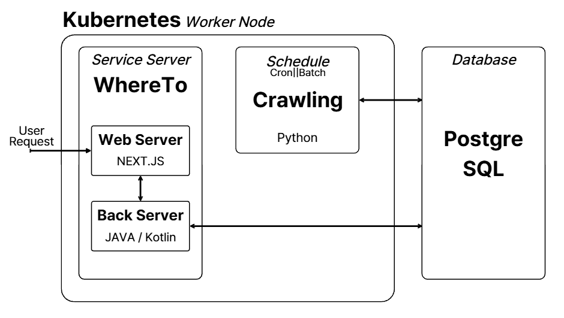

# 🐍Crawling | Python Toy Project
## 📌Purpose
This project crawls Naver blog posts, calculates an interest score based on the number of blog posts, and stores the processed data in a PostgreSQL database.

## 🎄To-be Architecture

## 🛠 Tech Stack
- ***Python***
- ***Scrapy***
- ***FastAPI***
- ***PostgreSQL***
- ***SQLAlchemy***

### Setup
>pip install -r requirements.txt

`.env.example`을 `.env`로 복사하고 DB 접속 정보와 API 키를 채웁니다.

### Crawling (API와 별도 실행)
>scrapy crawl naver_crawling -a prov=서울특별시
>scrapy crawl naver_crawling -a query="용인 에버랜드 후기"   # 검색어 하나만 크롤링

크롤링한 글 → `blog_content_loader`가 장소를 찾아 영업시간과 함께 DB에 저장 → API는 저장된 장소만 추천

추가 수집기 (.env에 키 필요)
>scrapy crawl daum_crawling -a query="강릉 카페"        # Tistory 등, KAKAO_REST_API_KEY
>scrapy crawl youtube_crawling -a query="강릉 카페 브이로그"  # YOUTUBE_API_KEY (하루 검색 약 90회 한도)

광고/AI글 Claude 2차 판정: `.env`에 `AI_CHECK_WITH_LLM=1`, `ANTHROPIC_API_KEY` 설정 (룰로 애매한 글만 호출, API 비용 발생)

### API
>python -m uvicorn source.src.api.main:app --port 8000

### Web
>cd web && npm install && npm run dev

`web/.env.local` (선택)
- `API_URL` : 백엔드 주소 (기본 `http://localhost:8000`)
- `NEXT_PUBLIC_NAVER_MAP_CLIENT_ID` : 네이버 지도 키. 없으면 지도 없이 목록만 표시

### DB 스키마 변경 (최초 1회)
>python -m source.src.sqlalchemy.db_script.migrate

### 매일 배치 (크롤링 → 장소 적재 → 점수)
>python -m source.src.run_daily 서울특별시

Windows 작업 스케줄러 등록 (매일 04:00):
>schtasks /Create /SC DAILY /ST 04:00 /TN CrawlingDaily /TR "cmd /c cd /d C:\WorkSpace\Crawling && (if not exist logs mkdir logs) && .venv\Scripts\python -m source.src.run_daily 서울특별시 >> logs\daily.log 2>&1"
### 배포 / 앱
- 웹은 PWA로 설정됨: HTTPS로 배포하면 휴대폰에서 "홈 화면에 추가"로 앱처럼 실행
- 배포 구성 예: 웹(Next.js) → Vercel 등, API(FastAPI)·PostgreSQL·배치 → 서버 1대 (웹의 `API_URL`을 API 주소로)
- 스토어 등록이 필요해지면 Expo(React Native)로 전환
